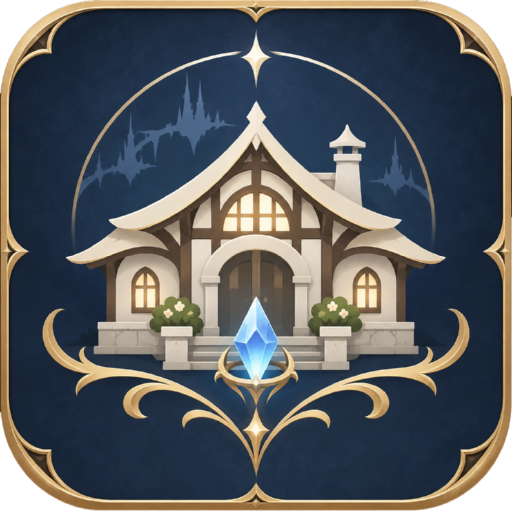

<p align="center"></p>

# Haven

Haven is a [Dalamud](https://github.com/goatcorp/Dalamud) plugin for Final Fantasy XIV that gives you housing interiors of your own, without owning a house in the game. Homes are saved on your PC, furnished with the full housing catalogue, and can be shared with friends for roleplay.

Everything Haven shows is drawn on your own client. Nothing is placed on the game's servers, and your character never leaves the spot where you entered.

> **Status: invite-only alpha.** Anyone can install Haven and use it on their own. Hosting or joining a gathering needs a Haven account, and new accounts currently need a one-time access code from the maintainer.

## Features

**Homes**
- Twenty interior shells (apartments, cottages, houses, mansions) and the game's inn rooms.
- Homes saved per character, with backups, and import/export as `.haven.json`.
- Copy the layout of a real house you're standing in, or import a [MakePlace](https://jawslouis.github.io/MakePlaceDocs/) layout.

**Furnishing**
- The full housing catalogue with real names and icons, search, favourites and recently used items.
- Placement with the mouse or exact values: move, turn, tilt, scale, grid and edge snapping, undo and redo.
- Linked groups, copies in rows, circles and mirrors, saved groups, and a free building camera.
- Remodel mode: remove or move the shell's own walls, pillars and fixtures.
- A World catalogue of the game's own world models (about 100,000), drawn from your installed game data.

**How furniture behaves**
- Collision, and `/sit`, `/doze` and `/cpose` on seats and beds.
- Doors, clocks, lamps and switches, animations, effects and ambient sounds, as in the game.
- Dyes, paintings, partition wallpapers, vase flowers, flowerpots, aquariums and fish prints.

**Atmosphere and music**
- Wallpaper, flooring and lighting per floor, room brightness, time of day, weather and outdoor sounds, saved as moods.
- A virtual orchestrion with playlists, using the game's own tracks or your own songs.

**Gatherings**
- Host your home and friends join with a visit code, or invite friends standing nearby.
- Movement, emotes and appearance sync; sync plugins such as Lightless keep working.
- Room chat and typing indicators that stay inside the gathering.
- Decorate together: guests' changes wait for the owner's approval.

**Roleplay**
- Pose balls with game emotes or Penumbra animation mods, adjustable per person.
- NPCs you dress (Glamourer and Customize+ supported), place and play as.
- Minions, the Gold Saucer's arcade machines, and Triple Triad against NPCs or each other.

**Your own content**
- Your own pictures in frames, your own songs, and furniture or animation mods from Penumbra.
- Shared only with guests who agree to load them. See [Safety and privacy](docs/SAFETY.md).

## Requirements

- Windows and FFXIV with Dalamud (API 15).
- [Stagehand](https://stagehandxiv.com), for furnishing lights and effects.
- [Penumbra](https://github.com/xivdev/Penumbra) for custom pictures, songs, furniture and animations.
- Optional: Glamourer and Customize+ for NPC looks.

## Installing

See [Installing Haven](docs/INSTALL.md). In short, add this custom repository in `/xlsettings` → Experimental:

```
https://raw.githubusercontent.com/queenofardour/Haven/feed/pluginmaster.json
```

Then install Haven from `/xlplugins` and type `/haven`.

## Safety and privacy

Haven is built so it can't affect your real character or the game world. In short:

- Inside a home, Haven holds back the packets the game would send to its servers, so your character stays where you entered. You return to that spot when you leave.
- Haven refuses to start in duties, PvP, duty queues, combat and cutscenes.
- Gatherings use Haven's own relay server, never the game's servers. It carries what a gathering needs: the home's layout, members' movement and emotes, room chat and music.
- Signing in uses Discord's `identify` scope only: your Discord ID and display name.

Read [Safety and privacy](docs/SAFETY.md) for what Haven sends, what it stores and what it never touches.

## Building from source

Requires Windows, the .NET 10 SDK and Dalamud's development assemblies (normally in `%APPDATA%\XIVLauncher\addon\Hooks\dev`).

```powershell
.\scripts\build.ps1
```

This builds the plugin, the relay and the tests, and runs the automated checks. Every release is built by [GitHub Actions](.github/workflows/release.yml) from the tagged source, and its source archive is attached to the release.

| Folder | What's there |
| --- | --- |
| `src/Haven` | The plugin: interface, furnishing, the native zone engine, networking |
| `src/Haven.Core` | Shared formats, protocol and game-file readers |
| `src/Haven.Relay` | The relay server for gatherings |
| `infra/cloudflare` | The hosted relay's edge Worker: sign-in, content storage, invitations |
| `tests/Haven.Tests` | Automated checks |

## Credits and licence

Haven is licensed under the [GNU AGPL v3](LICENSE). See [THIRD_PARTY_NOTICES.md](THIRD_PARTY_NOTICES.md) for attributions, every component, and its licence.

Haven is a fan project and isn't affiliated with Square Enix. FINAL FANTASY XIV © SQUARE ENIX CO., LTD. No game files are included; Haven reads your own installed game data.
